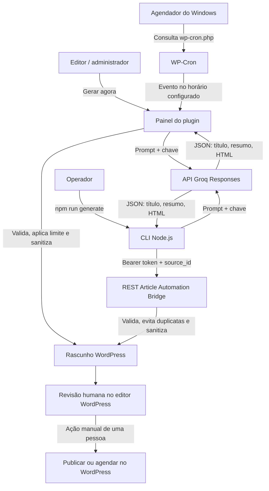

# Fluxo e funcionamento

Este documento descreve a arquitetura, as duas formas de gerar conteúdo, as
configurações, o agendamento e o processo de revisão. O sistema foi pensado
para preparar artigos para avaliação editorial: **a automação cria rascunhos,
mas nunca publica nem agenda a publicação de artigos**.

## 1. Visão geral

O projeto tem duas formas independentes de iniciar uma geração:

1. **Painel do WordPress:** o plugin chama a API Groq e salva os artigos
   diretamente no próprio WordPress.
2. **CLI Node.js:** o programa local chama a API Groq e envia cada artigo ao
   endpoint REST protegido do plugin WordPress.

Ambos os fluxos usam a Groq para gerar o texto e terminam em um post WordPress
com status `draft`. O painel e a CLI têm configurações separadas; alterar tema
ou limite em um não atualiza automaticamente a configuração do outro.



## 2. Componentes do projeto

| Caminho | Responsabilidade |
| --- | --- |
| `src/cli.js` | Lê opções do terminal, carrega configurações, executa geração, verifica tamanho e coordena o envio de rascunhos. |
| `src/config.js` | Valida perfis de site, endpoint, modelo e variáveis de ambiente. |
| `src/article-generator.js` | Cria o prompt, chama a Responses API da Groq, extrai o texto e valida o JSON e o HTML permitido. |
| `src/wordpress-client.js` | Monta o payload REST, cria o `source_id`, autentica com Bearer e confirma que o WordPress criou um rascunho. |
| `config/sites.example.json` | Exemplo público de perfil de site; não contém tokens. |
| `config/sites.json` | Configuração privada dos perfis locais; ignorada pelo Git. |
| `.env.example` | Modelo das variáveis de ambiente sem valores secretos. |
| `.env.local` | Chave Groq e tokens locais; ignorado pelo Git. |
| `wordpress-plugin/article-automation-bridge/article-automation-bridge.php` | Registra o endpoint REST, verifica o token e salva artigos recebidos como rascunhos. |
| `wordpress-plugin/article-automation-bridge/admin.php` | Implementa a tela de configuração, geração direta, controle de fila e WP-Cron. |
| `wordpress-plugin/article-automation-bridge/scripts/` | Scripts PowerShell para acionar o WP-Cron pelo Agendador de Tarefas do Windows. |
| `tests/wordpress-automation.test.js` | Testes de geração simulada, validação, CLI, autenticação e idempotência. |

## 3. Fluxo A: gerar pelo painel do WordPress

1. O administrador abre **Configurações > Automação de artigos**.
2. Preenche as definições editoriais, salva a chave da Groq e escolhe a quantidade
   por execução.
3. Ao selecionar **Gerar rascunhos agora**, o plugin confere a permissão
   `manage_options`, valida o nonce do formulário e adquire um bloqueio para
   impedir duas gerações simultâneas.
4. O plugin conta os posts gerados pela automação que ainda estão em `draft`
   ou `pending`. Se a fila atingir o limite máximo, não chama a API.
5. Para cada post permitido no lote, escolhe um tema da lista (ou deixa a IA
   propor um dentro do nicho) e envia um prompt à Groq.
6. A resposta precisa conter `title`, `excerpt` e `content`. O plugin confere o
   mínimo de palavras do corpo e remove HTML que não seja permitido pelo
   WordPress.
7. O post é inserido exclusivamente com status `draft`, na categoria escolhida.
   Um identificador interno é salvo para que esse rascunho seja contado na fila.
8. O administrador revisa o conteúdo em **Posts > Todos os posts**. Publicar ou
   agendar a publicação é uma decisão manual, posterior à revisão.

Se uma etapa falhar, o painel apresenta uma mensagem e o erro é registrado no
log do PHP/WordPress. Uma chamada à Groq pode consumir créditos mesmo que a
resposta seja rejeitada pelo mínimo de palavras ou por validação.

### Configurações disponíveis no painel

| Configuração | Uso |
| --- | --- |
| Chave da API Groq | Credencial usada pelo fluxo do painel. Campo vazio mantém a chave já salva. |
| Modelo Groq | ID de um modelo ativo e disponível para a conta. O padrão do projeto é `openai/gpt-oss-120b`; disponibilidade pode variar por conta e mudar ao longo do tempo. |
| Nome do site | Identifica o site no contexto editorial enviado à IA. |
| Tema/nicho | Limita o assunto geral dos artigos. |
| Público-alvo | Ajusta a explicação ao leitor pretendido. |
| Idioma e tom | Orientam a linguagem e o estilo. |
| Mínimo de palavras | Limite inferior validado no corpo do artigo, entre 100 e 10.000. |
| Categoria | Categoria WordPress existente onde os rascunhos são criados. |
| Temas | Lista opcional, um tema por linha; o painel percorre a lista ao longo das gerações. |
| Regras editoriais | Instruções adicionais, uma regra por linha. |
| Posts por execução | Tamanho do lote, entre 1 e 5. |
| Máximo de rascunhos pendentes | Limite da fila automatizada, entre 1 e 500; o padrão inicial é 20. |
| Frequência e horário | Agenda geração diária ou semanal no fuso horário definido em Configurações > Geral do WordPress. |

A fila considera posts automatizados que continuam em `draft` ou `pending`.
Rascunhos escritos manualmente não entram nessa contagem. Quando uma pessoa
publica ou agenda um post revisado, ele deixa de ocupar uma vaga da fila.

## 4. Agendamento no Windows

O WordPress usa WP-Cron, que normalmente depende de visitas ao site para
executar tarefas atrasadas. No XAMPP local, o projeto inclui uma tarefa do
Windows que consulta `wp-cron.php` a cada minuto. O plugin só gera no horário
diário ou semanal configurado; as consultas de minuto em minuto não geram um
artigo a cada minuto.

1. Ative o plugin e salve as configurações no painel.
2. Mantenha Apache e MySQL do XAMPP ativos.
3. Em PowerShell, registre a tarefa:

   ```powershell
   powershell -ExecutionPolicy Bypass -File "C:\xampp\htdocs\wordpress\wp-content\plugins\article-automation-bridge\scripts\register-windows-cron-task.ps1"
   ```

4. O script usa por padrão `http://localhost/wordpress`. Para outro endereço,
   passe `-SiteUrl "http://localhost/outro-site"`.
5. No Agendador de Tarefas, confirme que a tarefa
   `WordPress Article Automation WP-Cron` está habilitada.
6. Para remover o acionador:

   ```powershell
   Unregister-ScheduledTask -TaskName "WordPress Article Automation WP-Cron" -Confirm:$false
   ```

Essa tarefa apenas dispara o WP-Cron. A agenda do artigo continua sendo a
frequência e o horário salvos no painel. Se o computador ou o XAMPP estiver
desligado, a execução não ocorre naquele momento; quando o site voltar a ser
consultado, o WP-Cron pode executar eventos atrasados.

## 5. Fluxo B: gerar pelo Node.js

O fluxo da CLI é independente das configurações do painel:

1. `src/cli.js` interpreta o perfil `--site`, quantidade, tema, categoria e
   `--dry-run`.
2. `src/config.js` carrega `config/sites.json`, lê `.env.local` por meio do
   dotenv e valida campos, endpoint e tokens.
3. `src/article-generator.js` monta as instruções a partir do perfil e envia
   `POST /v1/responses` para a Groq com `store: false`.
4. A resposta precisa incluir um objeto JSON com título, resumo e HTML. Scripts,
   estilos e iframes são rejeitados.
5. A CLI conta as palavras no texto do corpo e interrompe o fluxo se o artigo
   ficar abaixo de `minWords`.
6. Sem `--dry-run`, `src/wordpress-client.js` envia o conteúdo ao endpoint REST
   do plugin com `Authorization: Bearer ...`.
7. O plugin verifica o token, valida a categoria, recusa um `source_id`
   repetido e cria o post como `draft`.

Exemplos:

```powershell
# Gerar um artigo de pré-visualização; ainda chama a Groq, mas não chama WordPress.
npm run generate -- --site local --topic "Tema do artigo" --dry-run

# Gerar e enviar um rascunho ao WordPress.
npm run generate -- --site local --topic "Tema do artigo"

# Gerar três artigos usando temas/categorias configurados no perfil.
npm run generate -- --site local --count 3

# Escolher uma categoria configurada no perfil.
npm run generate -- --site local --topic "Tema do artigo" --category "Guias"
```

`--dry-run` evita somente o envio ao WordPress; ele **não** evita a chamada à
Groq nem eventual consumo de créditos. O conteúdo é impresso no terminal para
revisão. A opção `--count` precisa ser um inteiro maior que zero.

### Identificação de duplicatas na CLI

O cliente Node cria um `source_id` estável com perfil, data, assunto e posição
na execução. Se o mesmo identificador já existir, o plugin responde HTTP 409 e
o cliente reconhece a duplicata sem criar outro post. Uma nova execução em
outra data pode gerar outro identificador.

## 6. API REST do plugin

O endpoint recebe posts do cliente Node. Em WordPress com permalinks REST:

```text
POST /wp-json/article-automation/v1/articles
```

Com permalinks padrão no XAMPP, use o formato configurado no perfil, com
`?rest_route=/article-automation/v1/articles`.

Cabeçalhos:

```text
Authorization: Bearer <token configurado fora do repositório>
Content-Type: application/json
```

Exemplo de formato do corpo (valores ilustrativos):

```json
{
  "title": "Título do artigo",
  "excerpt": "Resumo curto",
  "content": "<p>Texto...</p>",
  "slug": "titulo-do-artigo",
  "category_id": 1,
  "source_id": "wp-auto:local:2026-11-03:tema:1"
}
```

O token é definido como `ARTICLE_AUTOMATION_BRIDGE_TOKEN` no `wp-config.php` e
referenciado pela variável `WP_LOCAL_TOKEN` (ou outra declarada no perfil) em
`.env.local`. O endpoint compara segredos com `hash_equals`, sanitiza os
campos, valida a categoria e retorna o ID e link de edição quando o rascunho é
criado.

## 7. Configuração e instalação

### Projeto Node

1. Instale Node.js 20 ou superior.
2. Copie `.env.example` para `.env.local`.
3. Preencha `AI_API_KEY` com uma chave criada em
   [Groq Console](https://console.groq.com/keys). Confirme o modelo ativo na
   [lista de modelos Groq](https://console.groq.com/docs/models).
4. Copie `config/sites.example.json` para `config/sites.json`.
5. Configure o perfil do site: assunto, idioma, público, tom, categorias,
   tamanho mínimo e endpoint WordPress.
6. Configure no `.env.local` o token WordPress que corresponde ao token do
   `wp-config.php`.
7. Execute `npm install` e `npm test`.

### Plugin WordPress

Copie `wordpress-plugin/article-automation-bridge/` para
`wp-content/plugins/article-automation-bridge/` da instalação ativa do
WordPress, ative o plugin em **Plugins** e abra
**Configurações > Automação de artigos**. O fluxo do painel chama a Groq
diretamente e não depende da CLI Node, de `config/sites.json` ou do endpoint
REST.

## 8. Segurança e privacidade

- Nunca versione `.env.local`, `config/sites.json`, `wp-config.php`, chaves ou
  tokens. `.gitignore` exclui os dois arquivos privados locais.
- `.env.example` contém nomes e valores de exemplo, não credenciais reais.
- O fluxo da CLI envia a chave Groq somente à API Groq e o token WordPress
  somente à instalação WordPress configurada.
- O painel guarda a chave Groq nas opções do banco WordPress. Ela não é
  renderizada de volta no campo da tela, mas não está criptografada pelo plugin;
  proteja o banco, os backups e o acesso de administradores.
- A integração local pode usar HTTP somente para `localhost`; endpoints
  externos exigem HTTPS na validação do cliente.
- `store: false` é enviado à Groq no fluxo Node e no painel WordPress.
- O plugin limita operações do painel a administradores (`manage_options`) e
  valida nonces dos formulários.
- A automação não tem código para mudar um artigo para `publish` ou `future`.
  A revisão, aprovação e publicação permanecem no editor WordPress.
- Se uma chave ou token for exposto, revogue-o no serviço de origem e configure
  um novo valor; não o compartilhe em mensagens ou capturas de tela.

## 9. Erros e solução de problemas

| Sintoma | O que verificar |
| --- | --- |
| HTTP 401 da Groq | Se a chave configurada é uma API key Groq ativa, sem espaços extras ou revogação. Não é a senha do serviço. |
| HTTP 404 / `model_not_found` | Se o ID está ativo e disponível para a conta na lista de modelos da Groq. |
| HTTP 400 da Groq | Leia a mensagem e o request ID apresentados pelo cliente; confirme endpoint, modelo e parâmetros suportados. |
| `AI_API_KEY` não configurada | Confira a variável em `.env.local`, sem publicar o arquivo. |
| Token WordPress ausente ou 401 | Compare o valor local `WP_LOCAL_TOKEN` com `ARTICLE_AUTOMATION_BRIDGE_TOKEN` no `wp-config.php`, sem colocar nenhum dos dois em logs. |
| Categoria inválida | Confirme que o ID informado em `wordpress.categoryIds` pertence ao site WordPress correto. |
| WordPress não acessível | Confirme Apache/MySQL no XAMPP, URL/porta, instalação ativa e endpoint REST. |
| Artigo abaixo do mínimo | Ajuste `minWords` ou solicite um artigo maior; o fluxo interrompe em vez de salvar texto curto. |
| Painel não aparece | Confirme que o plugin está ativo na instalação WordPress correta e que a conta tem permissão de administrador. |
| Agenda não dispara | Confirme horário e fuso no WordPress, Apache ligado e tarefa do Agendador habilitada; consulte `wp-cron.php` localmente. |
| Fila cheia | Revise os rascunhos automatizados; o limite impede novas chamadas à IA até liberar vagas. |

## 10. Testes e limites conhecidos

Execute os testes automatizados com:

```powershell
npm test
```

Os testes Node simulam as respostas da IA e do WordPress; eles não validam a
chave real, não consomem créditos e não criam posts reais. A geração pelo
painel usa PHP do WordPress e a API Groq; deve ser validada no site local antes
de ativar uma agenda recorrente. O horário depende de computador, XAMPP,
Agendador do Windows e WP-Cron disponíveis.

O artigo gerado ainda exige revisão factual, editorial, de direitos e de
adequação ao site. O mínimo de palavras e a sanitização HTML não substituem a
revisão humana.
